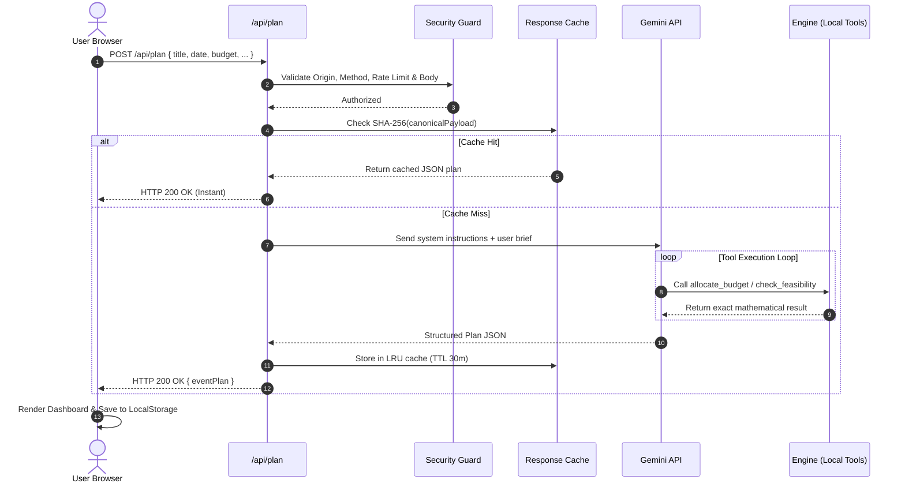

# Architecture of Utsav

Utsav is an AI-orchestrated celebration and event planner tailored for modern Indian events (weddings, milestone birthdays, and community festivals). It provides realistic budget allocation, vendor timelines, probabilistic guest attendance projections, and an interactive assistant with live plan patching.

---

## 1. Core Architectural Principle: "Model Judges, Code Calculates"

Large Language Models excel at natural language comprehension, cultural nuances, contextual trade-offs, and tone-appropriate communication. However, LLMs struggle with exact arithmetic, constraint satisfaction, and multi-currency rounding invariants.

Utsav solves this by strictly separating responsibilities:

- **Model Judges:** The LLM (Gemini 2.5 Flash Lite) interprets user intent, identifies missing planning details, generates creative celebration themes, structures vendor negotiation inquiries, and acts as an auditor/critic.
- **Code Calculates:** Deterministic JavaScript engine modules calculate exact budget apportionments (guaranteeing 100% budget conservation), project guest attendance using probabilistic formulas, determine mathematical feasibility ratios, and execute atomic patch mutations.

The model is prohibited from doing mental math; instead, it executes designated tools (`allocate_budget`, `check_feasibility`, `get_event_template`, `schedule_milestones`) whose results are computed deterministically.

---

## 2. System Topology

```
+-------------------------------------------------------------------------+
|                              Browser Client                             |
|  Pure ES Modules | Zero Bundler | Safe DOM Builder | LocalStorage v1    |
|                                                                         |
|  +------------------+    +--------------------+    +------------------+ |
|  |  Views & Tabs    |    |  Deterministic     |    | Storage & Router | |
|  |  - New Event     |    |  Engine Modules    |    | - Hash Router    | |
|  |  - Dashboard (7) |<-->|  - money.js        |<-->| - storage.js     | |
|  |  - Assistant Chat|    |  - feasibility.js  |    | - types.js       | |
|  |  - Vendor Modal  |    |  - catering.js     |    |                  | |
|  +------------------+    |  - patch.js        |    +------------------+ |
|                          |  - benchmarks.js   |                         |
|                          +--------------------+                         |
+-------------------------------------^-----------------------------------+
                                      | Fetch /api/* (HTTPS + JSON)
                                      v
+-------------------------------------------------------------------------+
|                       Vercel Serverless Functions                       |
|                                                                         |
|  +--------------------------------------------------------------------+ |
|  | Security Middleware (api/_lib/security.js)                         | |
|  | - Method: POST only                                                | |
|  | - Origin Verification (Host match & local dev)                     | |
|  | - Rate Limiter (30 req/min in-memory sliding window)               | |
|  | - Body Size Guard (32 KB cap) & Content-Type application/json      | |
|  | - Zod Input Schema Validation                                      | |
|  +----------------------------------+---------------------------------+ |
|                                     |                                   |
|               +---------------------+---------------------+             |
|               v                                           v             |
|     +-------------------+                       +-------------------+   |
|     | Cached Responses  |                       | Active Execution  |   |
|     | SHA-256 canonical |                       | Gemini Client     |   |
|     | 30-min TTL LRU    |                       | Tool Loop & Retry |   |
|     +-------------------+                       +---------+---------+   |
|                                                           |             |
+-----------------------------------------------------------|-------------+
                                                            | HTTPS
                                                            v
                                            +-------------------------------+
                                            |       Google Gemini API       |
                                            |       (gemini-2.5-flash)      |
                                            +-------------------------------+
```

---

## 3. Frontend Architecture

### 3.1 Zero-Build Vanilla ES Modules

The web client consists of pure ES2022 JavaScript modules served directly to modern browsers without bundlers (no Webpack, Vite, or Rollup). This guarantees instant loading, straightforward inspection, and zero dependency build steps.

### 3.2 Modular Component Structure

- `web/js/main.js`: Main bootstrap, hash route listener, application shell orchestration, and DOM replacement.
- `web/js/dom.js`: Secure DOM builder (`el`) and inline SVG icon repository. Invariant: **never** injects raw HTML into `innerHTML`.
- `web/js/views/new-event/`: Multi-step creation wizard:
  - `step-basics.js`: Event type selector and persona presets.
  - `step-details.js`: Headcount, budget, city, dates, and must-haves.
  - `step-intake.js`: Real-time AI intake analysis and validation.
  - `step-questions.js`: Dynamic clarification questions from the model.
  - `step-feasibility.js`: Pre-flight market feasibility verdict & trade-off suggestions.
  - `step-generate.js`: Parallel generation progress tracker and fallback runner.
- `web/js/views/overview/`: Tabular dashboard widgets:
  - `card-budget.js`, `card-progress.js`, `card-guests.js`, `card-milestone.js`, `card-tasks.js`, `card-feasibility.js`, `card-risks.js`, `export-bar.js`.
- `web/js/views/*-tab.js`: Dedicated dashboard views for Tasks, Budget, Vendors, Timeline, Guests, and Ideas.
- `web/js/views/assistant.js`: Collapsible AI chat assistant with patch preview and confirmation diffs.
- `web/js/views/vendor-outreach-modal.js`: Multi-channel (WhatsApp, Email) vendor communication drafter.

### 3.3 State Management & Offline Persistence

- `web/js/storage.js`: LocalStorage manager with versioning (`CURRENT_SCHEMA_VERSION = 1`), automatic corruption recovery, and active event resolution.
- Export & Backup: Supports RFC 5545 `.ics` timeline calendar export, JSON event backup/restore, and browser print stylesheet formatting.

---

## 4. Deterministic Computational Engine

Located in `web/js/engine/`:

### 4.1 `money.js` (Hamilton-Hare Budget Allocation)

Allocates total integer currency across categorical percentages using the largest remainder method:
$$\text{Remainder} = (\text{Budget} \times \text{Weight}) - \lfloor \text{Budget} \times \text{Weight} \rfloor$$
Guarantees the core invariant:
$$\sum_{i} \text{Allocated}_i \equiv \text{Total Budget}$$

### 4.2 `catering.js` (Probabilistic Attendance)

Calculates projected headcount from RSVP states:
$$\text{Expected Attendance} = \text{Confirmed} + \lfloor \text{Pending} \times \text{ShowUpRate} \rceil$$
Includes an additional 5% buffer recommendation for culinary inventory and food safety.

### 4.3 `feasibility.js` (Market Feasibility Verdict)

Evaluates planned budget against location- and season-adjusted market benchmarks:
$$\text{Ratio} = \frac{\text{Budget}}{\text{MinRealisticCost}}$$
Categorizes plan into four bands:

- `comfortable` ($\ge 1.4\times$)
- `tight` ($1.0\times - 1.39\times$)
- `short` ($0.7\times - 0.99\times$)
- `unrealistic` ($< 0.7\times$)

### 4.4 `patch.js` (Declarative Plan Mutation Engine)

Executes granular, validated atomic operations on the active plan:

- `add_task`, `update_task`, `delete_task`
- `update_budget_category`
- `add_vendor`, `update_vendor`
- `add_milestone`, `update_milestone`
- `update_guest_target`
- `add_idea`

---

## 5. Serverless Backend (`api/*`)

All API routes run as lightweight Vercel serverless functions:

| Route                 | Description                         | Method | Key Features                                                                     |
| --------------------- | ----------------------------------- | ------ | -------------------------------------------------------------------------------- |
| `/api/intake`         | Context completeness auditor        | `POST` | Identifies missing information and returns targeted clarification questions.     |
| `/api/plan`           | Parallel celebration plan generator | `POST` | Dispatches core plan, vendor recommendations, and creative concepts.             |
| `/api/critique`       | Plan auditor and safety critic      | `POST` | Audits generated plan for budget risks, timing bottlenecks, and missing permits. |
| `/api/assist`         | Conversational co-planner           | `POST` | Answers questions, provides suggestions, and yields structured patch operations. |
| `/api/vendor-message` | Outreach message drafter            | `POST` | Composes bilingual/Hinglish outreach inquiries for WhatsApp and Email.           |
| `/api/ping`           | Healthcheck and readiness probe     | `GET`  | Verifies server availability and uptime.                                         |

### 5.1 Security Middleware (`api/_lib/security.js`)

- **Strict Method Enforcement:** Rejects all non-POST methods with HTTP 405.
- **Strict Content-Type:** Demands `application/json` with HTTP 415.
- **Origin Verification:** Blocks cross-origin attacks by verifying Host headers and rejecting unauthorized foreign origins (e.g. `localhost.evil.com`).
- **Payload Guard:** Enforces a 32 KB maximum body size (HTTP 413).
- **In-Memory Rate Limiting:** Sliding-window rate limiter per client IP (30 req/min, HTTP 429).
- **Zod Schema Validation:** Strictly parses and validates all input payloads (HTTP 400).
- **Sanitized Errors:** Prevents internal stack traces or API keys from ever leaking to clients.

### 5.2 Deterministic Server-Side Cache (`api/_lib/cache.js`)

- Computes SHA-256 hashes over canonical, key-sorted JSON request bodies.
- Serves repeated identical requests instantly from in-memory LRU cache with 30-minute TTL.

### 5.3 Gemini Model Client (`api/_lib/gemini.js`)

- Connects to Google Gemini API (`gemini-2.5-flash`).
- Implements function calling tool loops for calculations and templates.
- Enforces JSON output structure matching Zod schemas.
- Automatic retry with exponential backoff on transient HTTP 429/503 errors.

---

## 6. End-to-End Request Lifecycle


